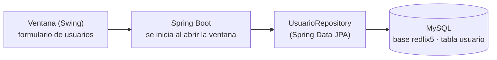

# Project-RedFlixPro-App

Aplicación de escritorio en Java para gestionar los usuarios de "RedFlix": permite crear, validar y eliminar usuarios (nombre, apellido, apodo, email, celular, fecha de nacimiento y contraseña) desde una ventana Swing, guardándolos en MySQL con Spring Boot y JPA. Proyecto de formación de 2020 (reto 5 del ciclo II).

## Cómo funciona



| Carpeta (`reto5/src/main/java/com/mintic/unal/`) | Contenido |
|---|---|
| `interfaz/` | La ventana y sus paneles |
| `modelos/` | La entidad `Usuario` |
| `repository/` | Acceso a datos con Spring Data JPA |
| `reto5/` | Arranque de la aplicación y acceso al contexto de Spring |

## Tecnologías

- Java 11
- Spring Boot 2.4 (Data JPA) con Maven
- MySQL
- Swing para la interfaz

## Cómo ejecutarlo

1. Ten un servidor MySQL en `localhost:3304` (el puerto habitual de MySQL es 3306; cámbialo en `reto5/src/main/resources/application.properties` si usas ese) y crea la base:

   ```sql
   CREATE DATABASE redlix5;
   ```

   La tabla `usuario` la crea la aplicación al arrancar.

2. Indica el usuario y la contraseña de MySQL y arranca:

   ```bash
   export DB_USER=root
   export DB_PASSWORD=tu_clave
   cd reto5
   ./mvnw spring-boot:run
   ```

## Estado de esta revisión

ESTADO_COMPILACION

Lo que no se pudo comprobar: la ejecución completa, porque necesita MySQL y un entorno gráfico.

## Problemas conocidos

Detectados leyendo el código y sin corregir todavía, porque no se pueden probar sin ejecutar la aplicación:

- Las contraseñas se guardan en texto plano en la columna `contraseña`.
- `Ventana` y `Panel1` repiten casi la misma lógica, y hay dos repositorios idénticos (`UsuarioRepository` y `UsuarioRepository1`).
- `Panel2` y `Panel3` están vacíos.
- Spring Boot 2.4 y el conector `mysql-connector-java` ya no reciben actualizaciones.
- La prueba incluida solo carga el contexto y falla si MySQL no está disponible.

## Licencia

CC0 1.0 Universal. Ver [LICENSE](LICENSE).
